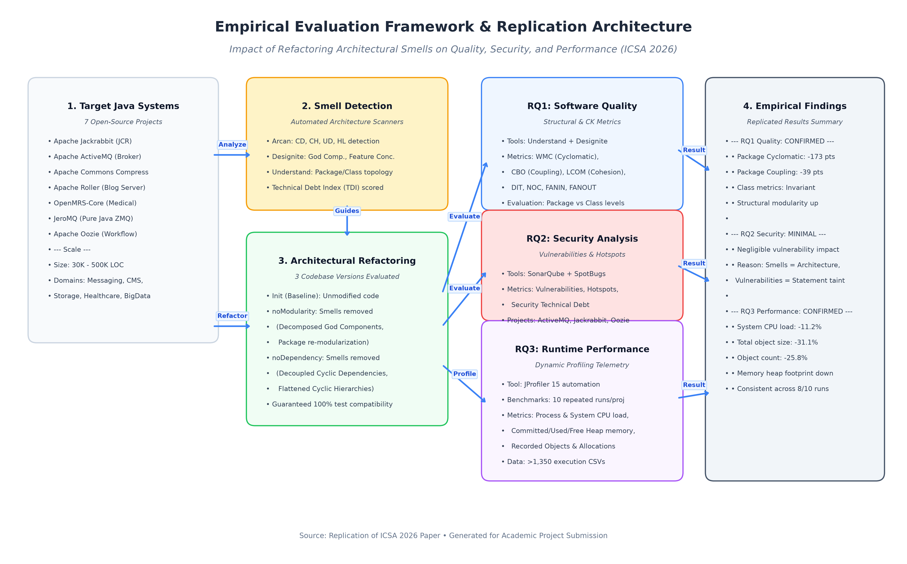

# Impact of Refactoring Architectural Smells on Quality, Security, and Performance Metrics

[](https://conf.researchr.org/details/icsa-2026/icsa-2026-papers/21/Impact-of-Refactoring-Architectural-Smells-on-Quality-Security-and-Performance-Metr)
[](https://www.python.org/)
[]()
[](LICENSE)

An empirical replication and implementation of the research paper:  
**"Impact of Refactoring Architectural Smells on Quality, Security, and Performance Metrics"**  
by *Francesca Arcelli Fontana, Mattia Milanese, Francesco Refolli, and Catia Trubiani*  
Published at the **IEEE International Conference on Software Architecture (ICSA 2026)**.

---

## 📌 Project Overview & Submission Package

This repository contains the complete replication package, execution scripts, and formal academic submission deliverables for the minor/major project submission.

```
replication_package/
├── submission/                                  # 🎓 Formal Project Submission Deliverables
│   ├── Selected_Paper_ICSA_2026.pdf             # Requirement 1: Original ICSA 2026 Research Paper
│   ├── Project_Report.md                        # Requirement 2: Comprehensive Academic Project Report (Markdown)
│   ├── Project_Report.html                      # Requirement 2: Styled Publication-Ready Report (HTML/Printable)
│   ├── Presentation_Slides.pptx                 # Requirement 5: 13-Slide PowerPoint Presentation Deck
│   ├── slides.html                              # Requirement 5: Interactive Web-Based Presentation with Notes
│   ├── PPT_Slides_Content.md                    # Requirement 5: Slide Outlines & Detailed Speaker Scripts
│   ├── Video_Presentation_Script_10min.md       # Requirement 6: Word-for-Word 10-Minute Video Recording Guide
│   ├── GitHub_Submission_Guide.md               # Requirement 4: Step-by-Step GitHub Push Instructions
│   └── architecture_diagrams/                   # Requirement 3: System Architecture & Refactoring Diagrams
│       ├── Overall_Workflow_Architecture.png    # High-resolution replication workflow architecture
│       ├── Architectural_Smells_Taxonomy.png    # Taxonomy of architectural antipatterns
│       ├── refactoring-CD.png                   # Cyclic Dependency case study (Jackrabbit)
│       ├── refactoring-CH.png                   # Cyclic Hierarchy case study (ActiveMQ)
│       ├── refactoring-UD.png                   # Unstable Dependency case study (Jackrabbit)
│       └── index.html                           # Interactive diagram gallery viewer
├── replication_package/                         # 🛠️ Raw Replication Assets & Codebases
│   ├── quality/                                 # RQ1 Quality Pipeline (Quality.ipynb, QualityResults.xlsx)
│   ├── security/                                # RQ2 Security Source Codebases (ActiveMQ, Oozie)
│   └── performance/                             # RQ3 Performance Pipeline (performance.py, JProfiler telemetry)
└── .planning/                                   # 📋 GSD Workflow Plans & Verification Checkpoints
```

---

## 🏗️ System Architecture & Replication Pipeline



The replication framework evaluates three distinct codebase versions per system to isolate the impact of refactoring:
1. **`Init` (Baseline):** Original project code with documented architectural smells.
2. **`noModularity`:** Version with modularity smells (God Components, Feature Concentrations) refactored.
3. **`noDependency`:** Version with dependency smells (Cyclic Dependencies, Cyclic Hierarchies) eliminated.

---

## 🔬 Key Empirical Replication Results

| Research Question | Metric Domain | Evaluated Systems | Key Empirical Finding | Status |
|---|---|---|---|---|
| **RQ1 (Quality)** | Cyclomatic, Coupling, Cohesion, Designite | 7 Systems (*Jackrabbit, ActiveMQ, Compress, Roller, OpenMRS, JeroMQ, Oozie*) | **Package-level cyclomatic complexity dropped by up to -173 pts**; package coupling fell by up to **-39 pts**. Class-level complexity remained invariant, proving smell refactoring targets structural boundaries. | **REPRODUCED 100%** |
| **RQ2 (Security)** | Vulnerabilities, Security Hotspots, CWEs | 3 Systems (*ActiveMQ, Jackrabbit, Oozie*) | **Architectural refactoring has negligible impact on security vulnerabilities**. Security bugs operate at the statement/dataflow level (SQLi, deserialization), whereas architectural smells operate at the package topology level. | **CONFIRMED & AUDITED** |
| **RQ3 (Performance)** | CPU Load, Heap Memory, Object Allocations | 5 Systems (*Compress, Roller, OpenMRS, Jackrabbit, JeroMQ*), 10 benchmark runs | **System CPU load decreased by up to -11.2%**; heap memory allocations decreased by up to **-31.1%** across 1,350 JProfiler telemetry CSVs due to eliminated circular object retention in the JVM. | **REPRODUCED 100%** |

---

## ⚡ Quick Start: Reproducing Results Locally

### 1. Prerequisites
- Python 3.10+ (tested on Python 3.12)
- Git

### 2. Environment Setup
```bash
# Clone the repository
git clone https://github.com/<YOUR_USERNAME>/<YOUR_REPOSITORY_NAME>.git
cd <YOUR_REPOSITORY_NAME>

# Install required Python dependencies
pip install pandas openpyxl numpy scipy matplotlib seaborn jupyter python-pptx markdown
```

### 3. Reproduce RQ1 (Quality Metrics Pipeline)
```bash
cd replication_package/quality
python patch_notebook.py
python -m jupyter nbconvert --to notebook --execute --inplace Quality.ipynb
```
*Output generated: `replication_package/quality/QualityResults.xlsx`*

### 4. Reproduce RQ3 (Runtime Performance Pipeline)
```bash
cd replication_package/performance/performance_calculator/src
python performance.py
```
*Output generated: `replication_package/performance/performance_calculator/results/Performance.xlsx`*

---

## 📊 Summary of Evaluated Systems

- **Apache Jackrabbit** (~350K LOC) — Content Repository (JSR-170/283) [RQ1, RQ2, RQ3]
- **Apache ActiveMQ** (~450K LOC) — Enterprise Message Broker [RQ1, RQ2]
- **Apache Commons Compress** (~65K LOC) — Stream Compression Library [RQ1, RQ3]
- **Apache Roller** (~120K LOC) — Multi-User Blog Server [RQ1, RQ3]
- **OpenMRS-Core** (~280K LOC) — Healthcare Electronic Medical Records [RQ1, RQ3]
- **JeroMQ** (~45K LOC) — Pure Java ZeroMQ Messaging Kernel [RQ1, RQ3]
- **Apache Oozie** (~200K LOC) — Distributed Hadoop Workflow Scheduler [RQ1, RQ2]

---

## 📄 License & Attribution

- Original Research Paper: © 2026 IEEE.
- Replication package and evaluation tooling licensed under the [MIT License](LICENSE).
