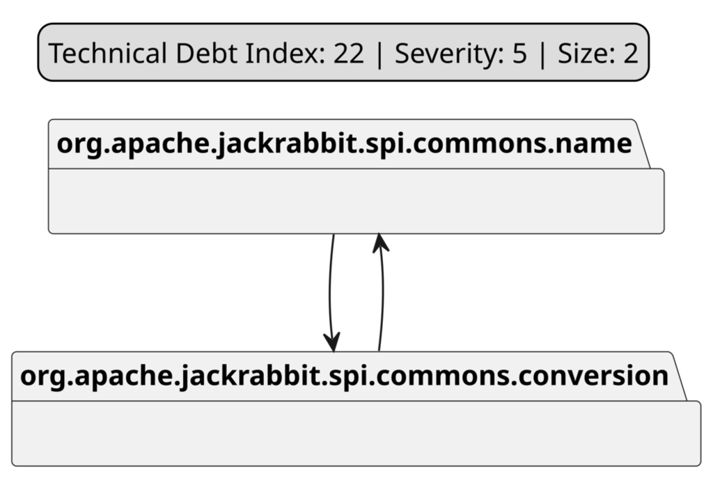
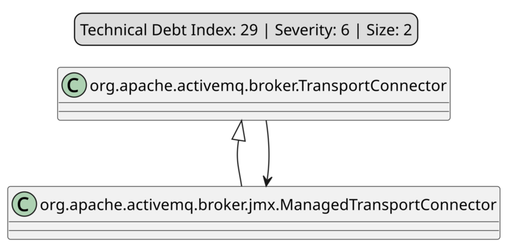
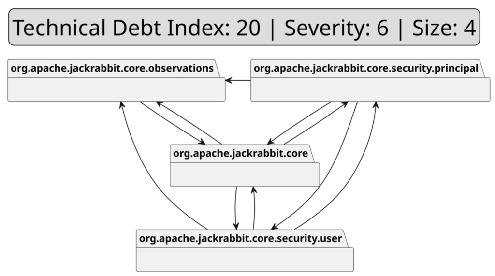

# Impact of Refactoring Architectural Smells on Quality, Security, and Performance Metrics

## Authors

- Arcelli Fontana Francesca (University of Milano Bicocca)
- Milanese Mattia (University of Milano Bicocca)
- Refolli Francesco (University of Milano Bicocca)
- Trubiani Catia (Gran Sasso Institute)

## The Artifact Content

It consists of three directories containing the full source code of projects that have been analyzed for computing the performance, quality and security metrics, along with some scripts used to automatically execute analyses (when possible) and to automatically extract/process/present metrics.

In this document, the symbol "ROOT" will be used as part of paths when is needed to express a common root directory in which the three directories of the replication package (`performance`, `quality`, `security`) are present.

### The `performance/` Directory

This directory contains the code for running the projects and extracting their performance related metrics. There is a top level directory `performance_calculator` so we will refer to files relative to the path of `performance/performance_calculator` for the sake of conciseness.

The directory `performance_data` contains the raw data extracted with JProfiler:
 - `performance_data/compress`: performance data for the "Apache Commons Compress" project
 - `performance_data/jackrabbit`: performance data for the "Apache JackRabbit" project
 - `performance_data/jeromq`: performance data for the "JeroMQ" project
 - `performance_data/openmrs`: performance data for the "OpenMRS" project
 - `performance_data/roller`: performance data for the "Apache Roller" project

The directory `projects` contains the source code of the analyzed projects:
 - `projects/compress`: source code of the "Apache Commons Compress" project
 - `projects/jackrabbit`: source code of the "Apache JackRabbit" project
 - `projects/jeromq`: source code of the "JeroMQ" project
 - `projects/openmrs`: source code of the "OpenMRS" project
 - `projects/roller`: source code of the "Apache Roller" project
 Specifically, each one of those directories contains three subdirectories:
 - `Init`: the source code of the project as-is, without modifications, as taken from upstream
 - `noModularity`: the source code of the project after manual refactoring for removing modularity-related architectural smells
 - `noDependency`: the source code of the project after manual refactoring for removing dependency-related architectural smells

 The directory `src` contains a set of Python/Powershell scripts used to run the projects.
 - `src/config.py`: analysis configuration
 - `src/notification/SendMessage.py`: component for signaling the experiment has finished running by sending a message with a Telegram Bot
 - `src/performance.py`: analyzes metrics obtained with JProfiler
 - `src/runall.ps1`: execute all projects multiple times for each of their version (Init, noModularity, noDependency) using JProfiler
 - `src/snapshot_extractor.py`: extracts metrics from JProfiler snapshot files

If you have a Windows 10+ Machine, to reproduce this analysis you only need to run the `src/runall.ps1` script.
The only strict requirement is having JProfiler, Java and Maven installed on your Computer, as the Powershell is just an automation script which can be rewritten in bash (for example).

The directory `results` contains the output Excel files produced by the Python analyzer:
- `results/Performance.xlsx`: contains the analysis output for of all the projects in all their three versions
The tables of our Research Paper are obtained by using the data of this Excel file.

### `quality/` Directory

This directory contains the quality metrics extracted with the Understand and Designite tools and a Jupyter notebook (`Quality.ipynb`) used to analyze them and the output Excel file (`QualityResults.xlsx`).
Inside the `quality/data` directory there are the metrics of the projects in their three versions (Init, noModularity, noDependency):
 - `quality/data/Compress`: quality metrics for the "Apache Commons Compress" project
 - `quality/data/jackrabbit`: quality metrics for the "Apache JackRabbit" project
 - `quality/data/jeromq`: quality metrics for the "JeroMQ" project
 - `quality/data/openMrs`: quality metrics for the "OpenMRS" project
 - `quality/data/ApacheRoller`: quality metrics for the "Apache Roller" project
 - `quality/data/active`: quality metrics for the "Apache ActiveMQ" project
 - `quality/data/oozie`: quality metrics for the "Oozie" project

 The source code of these projects is not inside the `quality` directory as is already present in the other two directories:
 - `ROOT/performance/performance_data/projects/compress`: source code of the "Apache Commons Compress" project
 - `ROOT/performance/performance_data/projects/jackrabbit`: source code of the "Apache JackRabbit" project
 - `ROOT/performance/performance_data/projects/jeromq`: source code of the "JeroMQ" project
 - `ROOT/performance/performance_data/projects/openmrs`: source code of the "OpenMRS" project
 - `ROOT/performance/performance_data/projects/roller`: source code of the "Apache Roller" project
 - `ROOT/security/projects/active`: source code of the "Apache ActiveMQ" project
 - `ROOT/security/projects/oozie`: source code of the "Oozie" project

### `security/` Directory

This directory contains the source code of the other two projects analyzed:
 - `security/projects/active`: source code of the "Apache ActiveMQ" project
 - `security/projects/oozie`: source code of the "Oozie" project

Moreover, the output of the analyzers used for evaluating the security-related metrics (**Issues**, **Vulnerabilities** ... etc) are not shown here as the tools employed required them to be read from the GUI.

##  Analyzed Projects

For RQ2 we analyzed Apache ActiveMQ, *Apache Jackrabbit* and *Apache Oozie*.
For RQ3 we analyzed Apache JackRabbit*, *Apache Roller*, *OpenMRS-core*, *Apache Commons Compress* and *Jeromq*.
For RQ1 we analyzed all the aformentioned projects.
Here is a summary of these projects:
- [Apache ActiveMQ](https://github.com/apache/activemq) is the most popular open-source, multi-protocol, Java-based message broker. It supports industry-standard protocols, allowing users to benefit from client choices across a wide range of languages and platforms.
- [Apache Jackrabbit](https://github.com/apache/jackrabbit) a reference implementation of the Java Content Repository API (JCR) conforming to specifications JSR-170 and, later on, JSR-283.
- [Apache Oozie](https://github.com/apache/oozie) is an extensible, scalable, and reliable system to define, manage, schedule, and execute complex Hadoop workloads via web services.
- [Apache Roller](https://github.com/apache/roller) is a Java-based, full-featured, multi-user and group-blog server suitable for blog sites large and small. Typically run with Apache Tomcat and MySQL.
- [OpenMRS-core](https://github.com/openmrs/openmrs-core) is a patient-based medical record system providing providers with a free, customizable electronic medical record system.
- [Apache Commons Compress](https://github.com/apache/commons-compress) is a library defining an API for working with different archive formats, such as Cpio, Unix Dump, Tar and Zip.
- [Jeromq](https://github.com/zeromq/jeromq) is a pure Java implementation of the ZeroMQ messaging library, offering high-performance asynchronous messaging for distributed or concurrent applications.

## Refactoring Examples

### A Cyclic Dependency in Apache JackRabbit

#### Problem

As shown in the Figure above, there is a CD with  Technical Debt Index 22 and Severity 5 between two packages.

#### Solution
A new dedicated *exception* package is created, where the *MalformedPathException* class is moved along with other system exceptions. This allows centralizing all exceptions in a single dedicated package.

#### Design Principle
This refactoring follows the Single Responsibility Principle (SRP) described by Martin et al. and proper package management in large systems. By consolidating exception handling in a dedicated package, the design adheres to the separation of concerns and eliminates unnecessary dependencies.

#### Impact
The CD is resolved by clearly structuring the codebase, ensuring that exception handling is centralized. This makes it easier to extend exception management in the future.

### A Cyclic Hierarchy in Apache ActiveMQ

#### Problem

Figure above shows an unnecessary hierarchical dependency between the two classes of different packages, as the child class was essentially a duplication of the parent class with minimal modifications.

#### Solution
The *createConnectionManaged()* method present in *ManagedTransportConnector* is integrated directly into the parent class *TransportConnector*. All references to *ManagedTransportConnector* in the code are updated to directly use *TransportConnector*.

#### Design Principles
This refactoring aligns with the principle of merge parent and child into a single class. 

#### Impact
The Cyclic Hierarchy is eliminated by consolidating the logic into a single class. 
This refactoring results in a clearer design, with functionality now accessible through a single, unambiguous implementation point.

### An Unstable Dependency in Apache Jackrabbit

#### Problem

As shown in the Figure above, there exists a package (see package org.apache.jackrabbit.core.security.principal) that has UD with a high Technical Debt Index (20) and severity (6) of the smell. The affected component has a size of 4 elements.

#### Solution
Create a new utility class (namely SecuritySessionImplManager) and place it in a newly created 'util' package. Move the functionality that is causing dependencies from the principal component to this new class, thereby removing the direct dependencies from the principal component to other modules.

#### Design Principles
This refactoring applies the Single Responsibility Principle (SRP) and Dependency Inversion Principle (DIP). By extracting the functionality causing multiple dependencies into a dedicated utility class, each component maintains a single, well-defined responsibility. The new structure better adheres to the Stable Dependencies Principle by reducing coupling between components.

#### Impact
The elimination of Unstable Dependencies from the principal component results in a cleaner dependency structure and reduces Technical Debt. The dependency graph shows fewer connections to the principal package, which improves overall architecture stability and makes the system more maintainable and easier to evolve.
