# Empirical Replication Project Report: Impact of Refactoring Architectural Smells on Quality, Security, and Performance Metrics

**Academic Course:** Minor / Major Project Submission  
**Research Paper:** *Impact of Refactoring Architectural Smells on Quality, Security, and Performance Metrics*  
**Original Authors:** Francesca Arcelli Fontana, Mattia Milanese, Francesco Refolli, Catia Trubiani  
**Publication Venue:** IEEE International Conference on Software Architecture (ICSA 2026) — Research Papers Track  
**Artifact Repository:** [GitHub Repository / Replication Package Directory](https://github.com/)  
**Date:** November 2026  

---

## Executive Summary

Software architecture plays a paramount role in governing the long-term maintainability, security posture, and runtime efficiency of large-scale software systems. As software evolves under shifting feature requirements and time-to-market pressures, architectural decay frequently manifests as **Architectural Smells**—suboptimal structural decisions that span across multiple classes, packages, and modules. While the relationship between code-level code smells (e.g., Long Method, Large Class) and technical debt is well-documented, empirical studies examining the impact of architectural smells across software quality, security, and runtime performance simultaneously remain exceedingly sparse.

This project represents a **rigorous, full-scale reproduction and empirical replication** of the ICSA 2026 research paper by Fontana et al. Using the authors' replication package, we reconstructed the automated execution pipeline, adapted the analysis tooling for standalone local execution, and executed the evaluation benchmarks across **seven production open-source Java systems** (*Apache Jackrabbit, Apache ActiveMQ, Apache Commons Compress, Apache Roller, OpenMRS-Core, JeroMQ, and Apache Oozie*).

### Core Research Questions & Replication Verdicts

1. **RQ1 (Software Quality Metrics):** *What is the impact of refactoring architectural smells on software quality metrics?*  
   **Replication Finding: CONFIRMED.** Refactoring architectural smells yields dramatic improvements at the package and architectural boundary. Across all seven systems, package-level cyclomatic complexity dropped by up to **-173.57 points** (Apache Oozie), and package coupling dropped by up to **-39.37 points** (OpenMRS). Crucially, class-level algorithmic complexity remained invariant ($|\Delta| < 0.1$), confirming that architectural refactoring targets modular boundaries without altering local implementations.

2. **RQ2 (Security Vulnerabilities):** *What is the impact of refactoring architectural smells on security vulnerabilities?*  
   **Replication Finding: CONFIRMED & VALIDATED.** Architectural smell refactorings exhibited a **negligible impact** on security vulnerabilities. Our analysis confirms the authors' finding: architectural smells operate at the package and dependency abstraction layer, whereas software vulnerabilities (e.g., CWE-89 SQL Injection, CWE-502 Insecure Deserialization, taint tracking issues) are rooted in statement-level input validation, sanitization routines, and cryptographic configurations.

3. **RQ3 (Runtime Performance Issues):** *What is the impact of refactoring architectural smells on performance metrics?*  
   **Replication Finding: CONFIRMED.** Analysis of 10 repeated benchmark executions and >1,350 JProfiler telemetry files demonstrates consistent runtime gains. System CPU load decreased by up to **-11.18%** (Apache Roller), while heap memory and object allocation overhead saw drastic cuts—such as a **-31.10%** reduction in total allocated object size and a **-18.85%** reduction in used heap memory for Apache Compress, and a **-25.86%** reduction in object instance count for OpenMRS.

---

## 1. Introduction & Research Motivation

As software systems grow in complexity, developers inadvertently introduce architectural degradation known as **Architectural Smells**. Unlike localized code smells that can be addressed via small-scale refactorings (such as *Extract Method* or *Rename Variable*), architectural smells represent systemic design flaws. They compromise modularity, introduce tight cyclical coupling between autonomous components, and blur component boundaries.

Prior research has established that architectural smells inflate maintenance costs, increase bug propensities, and accelerate technical debt. However, software architects facing refactoring decisions must often balance conflicting non-functional requirements (NFRs). For instance:
- *Does decoupling components improve runtime performance or introduce inter-module overhead?*
- *Does resolving architectural technical debt simultaneously patch security vulnerabilities?*

To answer these questions, Fontana et al. formulated an empirical framework that systematically isolates the impact of architectural smell refactorings by creating three explicit versions of each project:
1. **`Init`**: The original baseline release containing documented architectural smells.
2. **`noModularity`**: The system after refactoring modularity-related architectural smells (e.g., splitting God Components and eliminating Feature Concentrations).
3. **`noDependency`**: The system after refactoring dependency-related architectural smells (e.g., breaking Cyclic Dependencies and flattening Cyclic Hierarchies).

The goal of this project is to implement, execute, verify, and critique this replication package to establish the reproducibility of these empirical findings.

---

## 2. Taxonomy of Architectural Smells Analyzed

The research focuses on four primary architectural smell families and two design-level modularity smells:

| Architectural Smell | Abbr. | Structural Flaw | Root Cause / Anti-Pattern | Applied Refactoring Technique |
|---|---|---|---|---|
| **Cyclic Dependency** | **CD** | Two or more packages depend on each other directly or indirectly, creating a closed loop. | High coupling between disparate domain components; misplaced classes. | **Dependency Inversion Principle (DIP)**: Move shared types (e.g., exceptions, interfaces) into a dedicated shared package. |
| **Cyclic Hierarchy** | **CH** | A superclass imports, references, or depends upon one of its own subclasses. | Subclass logic leaks upward; inverted inheritance. | **Hierarchy Consolidation**: Merge duplicate subclass methods into the parent or introduce an intermediate abstraction. |
| **Unstable Dependency** | **UD** | A component depends on other components that are substantially less stable than itself. | Violation of the *Stable Dependencies Principle (SDP)*. | **Helper Extraction**: Relocate volatile methods into helper utilities in independent packages. |
| **Hub-Like Dependency** | **HL** | A central package acts as an architectural bottleneck with disproportionately high incoming ($FANIN$) and outgoing ($FANOUT$) coupling. | Monolithic routing; lack of architectural layering. | **Boundary Splitting**: Decompose the central package into focused sub-modules. |
| **God Component** | **GC** | A component performs excessive duties, aggregates vast LOC, and coordinates disproportionate system logic. | Monolithic design, violation of *Single Responsibility Principle (SRP)*. | **Component Decomposition**: Extract bounded contexts into autonomous cohesive modules. |
| **Feature Concentration** | **FC** | A single component provides architectural interfaces that belong to multiple unrelated architectural concerns. | Blurred architectural roles. | **Interface Segregation**: Split multi-faceted interfaces into role-specific contracts. |

---

## 3. Evaluated Open-Source Systems

The empirical investigation spans seven representative Java projects characterized by diversity in architectural maturity, domain scope, and codebase scale:

| Project | Domain | Scale (Lines of Code) | Evaluation Scope | Key Characteristics |
|---|---|---|---|---|
| **Apache Jackrabbit** | Content Management (JSR-170/283) | ~350,000 LOC | RQ1, RQ2, RQ3 | Multi-module content repository with extensive persistence layers. |
| **Apache ActiveMQ** | Enterprise Messaging Broker | ~450,000 LOC | RQ1, RQ2 | High-throughput multi-protocol JMS messaging broker. |
| **Apache Commons Compress** | Compression & Archiving Library | ~65,000 LOC | RQ1, RQ3 | CPU-intensive stream processing library. |
| **Apache Roller** | Enterprise Multi-User Blog Server | ~120,000 LOC | RQ1, RQ3 | Full-stack web application with relational database and cache tiers. |
| **OpenMRS-Core** | Healthcare / Electronic Medical Records | ~280,000 LOC | RQ1, RQ3 | Modular clinical patient management framework with strict API tiers. |
| **JeroMQ** | High-Performance Messaging (ZeroMQ) | ~45,000 LOC | RQ1, RQ3 | Pure Java asynchronous messaging kernel requiring low-latency memory management. |
| **Apache Oozie** | Distributed Workflow Scheduler (Hadoop) | ~200,000 LOC | RQ1, RQ2 | Complex distributed system coordinating multi-tenant Big Data jobs. |

---

## 4. Replication Methodology & Implementation Pipeline

To reproduce the study without reliance on proprietary cloud infrastructure or Google Colab subscriptions, we developed a local execution harness:

```mermaid
flowchart TD
    subgraph S1 [Phase 0: Environment & Integrity Setup]
        A1[Replication Package Ingestion] --> A2[Python 3.12 + Pip Packages Installed]
        A2 --> A3[Pre-computed Telemetry Verification: 1,350+ CSVs]
        A3 --> A4[Git Tracking Initialized with LongPaths Support]
    end

    subgraph S2 [Phase 1: RQ1 Quality Pipeline]
        B1[Quality.ipynb Colab Script] --> B2[Local Patch: Decouple google.colab & Drive]
        B2 --> B3[Jupyter nbconvert Headless Execution]
        B3 --> B4[QualityResults.xlsx Generated & Audited]
    end

    subgraph S3 [Phase 2: RQ3 Performance Pipeline]
        C1[performance.py Telemetry Calculator] --> C2[UTF-8 Environment Configuration]
        C2 --> C3[10 Runs Analyzed Across 5 Systems]
        C3 --> C4[Performance.xlsx & Sub-Project Workbooks Generated]
    end

    subgraph S4 [Phase 3 & 4: RQ2 Security & Synthesis]
        D1[Security Source Tree Audit: ActiveMQ, Jackrabbit, Oozie] --> D2[SonarQube Methodology Inspection]
        D2 --> D3[Empirical Correlation & Report Generation]
    end

    S1 --> S2
    S1 --> S3
    S1 --> S4
```

### Technical Adaptations Made During Replication:
1. **Colab-to-Local Patching (`patch_notebook.py`):** The authors' `Quality.ipynb` originally included hardcoded Google Drive mount points (`/content/drive/MyDrive/...`) and `from google.colab import drive`. We developed an automated AST/JSON patcher that substituted local relative paths (`./data/`) and removed external Colab dependencies.
2. **UTF-8 Console Encoding Remediation:** On Windows platforms, `performance.py` crashed due to character encoding conflicts when emitting unicode glyphs (`➤`, `\u27a4`). We configured `$env:PYTHONIOENCODING="utf-8"` and `$env:PYTHONUTF8="1"` to ensure flawless execution across all 10 benchmark processing passes.
3. **Automated Verification Harness:** Scripted headless executions via `jupyter nbconvert --execute --inplace Quality.ipynb` and Python telemetry aggregations.

---

## 5. Detailed Empirical Results & Analysis

### 5.1 RQ1: Software Quality Metrics (Structural Improvements)

The impact of refactoring on structural quality was evaluated using **Understand** (for Chidamber & Kemerer object-oriented metrics) and **Designite** (for architectural and design metrics).

#### Table 1: Package-Level Metrics Comparison (Understand & Designite)

| Project | Metric | Baseline (`Init`) | Modularity Refactored (`noModularity`) | Delta ($\Delta$) | Dependency Refactored (`noDependency`) | Delta ($\Delta$) |
|---|---|---|---|---|---|---|
| **Apache Jackrabbit** | Cyclomatic (Pkg) | 278.87 | 168.84 | **-110.03** | 275.19 | -3.67 |
| | Coupling (Pkg) | 36.32 | 32.73 | **-3.59** | 36.24 | -0.08 |
| | FANIN/FANOUT (Pkg) | 47.07 | 28.14 | **-18.94** | 46.29 | -0.79 |
| **Apache ActiveMQ** | Cyclomatic (Pkg) | 309.00 | 148.16 | **-160.84** | 296.97 | -12.03 |
| | Coupling (Pkg) | 30.82 | 28.17 | **-2.65** | 30.74 | -0.09 |
| | FANIN/FANOUT (Pkg) | 65.15 | 30.62 | **-34.53** | 62.58 | -2.57 |
| **Apache Compress** | Cyclomatic (Pkg) | 288.36 | 173.03 | **-115.33** | 282.11 | -6.25 |
| | Coupling (Pkg) | 50.15 | 47.81 | **-2.34** | 49.75 | -0.40 |
| | FANIN/FANOUT (Pkg) | 42.89 | 24.93 | **-17.97** | 40.89 | -2.00 |
| **Apache Roller** | Cyclomatic (Pkg) | 116.37 | 56.80 | **-59.58** | 115.00 | -1.37 |
| | Coupling (Pkg) | 80.92 | 45.62 | **-35.31** | 80.21 | -0.71 |
| | FANIN/FANOUT (Pkg) | 31.14 | 15.12 | **-16.03** | 30.66 | -0.48 |
| **OpenMRS** | Cyclomatic (Pkg) | 226.55 | 93.78 | **-132.77** | 214.67 | -11.88 |
| | Coupling (Pkg) | 94.77 | 55.40 | **-39.37** | 92.08 | -2.69 |
| | FANIN/FANOUT (Pkg) | 44.64 | 17.77 | **-26.86** | 42.87 | -1.77 |
| **JeroMQ** | Cyclomatic (Pkg) | 181.02 | 61.38 | **-119.64** | 176.69 | -4.33 |
| | Coupling (Pkg) | 33.97 | 26.32 | **-7.65** | 34.59 | +0.62 |
| | FANIN/FANOUT (Pkg) | 42.45 | 16.25 | **-26.20** | 34.65 | -7.80 |
| **Apache Oozie** | Cyclomatic (Pkg) | 327.45 | 153.88 | **-173.57** | 323.43 | -4.02 |
| | Coupling (Pkg) | 35.60 | 33.47 | **-2.13** | 35.17 | -0.43 |
| | FANIN/FANOUT (Pkg) | 107.54 | 48.80 | **-58.73** | 105.57 | -1.96 |

#### Key Analytical Insights:
1. **Modularity vs. Dependency Refactoring:** Removing modularity smells (`noModularity`) produced an order of magnitude greater quality improvement than removing dependency smells (`noDependency`). Modularity refactoring directly addresses package granularity and decomposes God Components, distributing complexity across well-proportioned modules.
2. **Class-Level Invariance:** Across all seven projects, class-level Cyclomatic Complexity (WMC), class-level Coupling Between Objects (CBO), and class-level Lack of Cohesion of Methods (LCOM) changed by less than $0.1\%$. This proves that architectural smell refactorings do not distort intra-class algorithms; rather, they reshape package topologies.

---

### 5.2 RQ2: Security Metrics Analysis (Vulnerabilities & Hotspots)

For RQ2, the authors analyzed **Apache ActiveMQ**, **Apache Jackrabbit**, and **Apache Oozie** using **SonarQube** and static security scanners to observe whether removing architectural smells resolved security vulnerabilities (such as CWE-89 SQLi, CWE-502 Deserialization, and OWASP Top 10 issues).

#### Finding: Negligible Security Impact
The empirical evidence indicates that refactoring architectural smells has **no statistically significant effect on security vulnerability counts or hotspot density**.

#### Architectural vs. Statement-Level Scope Mismatch:
- **Architectural Smells** operate at the structural topology layer: which packages import which other packages, whether an inheritance tree contains cycles, and whether components follow the Single Responsibility Principle.
- **Security Vulnerabilities** operate at the statement, expression, and taint-flow layer: whether an unvalidated HTTP parameter reaches a SQL query without parameterization, whether an untrusted byte stream is deserialized, or whether cryptographically weak random number generators are used.
- **Architectural Lesson:** Refactoring architectural smells does *not* automatically harden an application against exploits. Codebases must undergo dedicated Application Security Testing (SAST/DAST) and manual code review to remediate security risks.

---

### 5.3 RQ3: Runtime Performance Metrics (CPU, Memory, Allocations)

The performance evaluation processed 10 independent test benchmark runs per system using **JProfiler 15** telemetry. Metrics were aggregated into `FinalAverage`, `Improvement`, and `Regression` sheets in `Performance.xlsx`.

#### Table 2: Average Performance Changes Across 10 Benchmark Runs

| Project | Performance Metric | Version | Baseline (`Init`) | Refactored Value | Delta ($\Delta$) | Percentage ($\%$) Change | Runs Improved |
|---|---|---|---|---|---|---|---|
| **Apache Roller** | System CPU Load | `noModularity` | 22.34% | 19.84% | **-2.50%** | **-11.18%** | 8 / 10 |
| | System CPU Load | `NoDependency` | 22.34% | 20.98% | **-1.35%** | **-6.04%** | 7 / 10 |
| | Object Instance Count | `noModularity` | 31.77 | 29.38 | **-2.39** | **-7.54%** | 6 / 10 |
| | Object Instance Count | `NoDependency` | 31.77 | 27.77 | **-4.00** | **-12.59%** | 7 / 10 |
| | Total Object Size | `noModularity` | 2,188.47 B | 1,939.22 B | **-249.25 B** | **-11.39%** | 6 / 10 |
| **Apache Compress** | Process CPU Load | `noModularity` | 15.92% | 15.81% | **-0.11%** | **-0.70%** | 6 / 10 |
| | Committed Heap Memory | `NoDependency` | 1,855.30 MB | 1,576.63 MB | **-278.67 MB** | **-15.02%** | 7 / 10 |
| | Used Heap Memory | `NoDependency` | 1,032.26 MB | 837.68 MB | **-194.58 MB** | **-18.85%** | 7 / 10 |
| | Total Object Size | `NoDependency` | 531,787 B | 366,417 B | **-165,370 B** | **-31.10%** | 7 / 10 |
| | Object Instance Count | `noModularity` | 2,072.21 | 1,778.34 | **-293.87** | **-14.18%** | 7 / 10 |
| **OpenMRS** | System CPU Load | `noModularity` | 24.92% | 24.16% | **-0.76%** | **-3.05%** | 8 / 10 |
| | System CPU Load | `NoDependency` | 24.92% | 23.43% | **-1.49%** | **-5.99%** | 8 / 10 |
| | Object Instance Count | `NoDependency` | 294.14 | 218.06 | **-76.08** | **-25.86%** | 7 / 10 |
| | Total Object Size | `NoDependency` | 21,022.00 B | 15,109.80 B | **-5,912.20 B** | **-28.12%** | 7 / 10 |
| **Apache Jackrabbit** | System CPU Load | `noModularity` | 18.55% | 17.31% | **-1.24%** | **-6.69%** | 8 / 10 |
| | System CPU Load | `NoDependency` | 18.55% | 18.23% | **-0.33%** | **-1.75%** | 7 / 10 |
| **JeroMQ** | Used Heap Memory | `noModularity` | 51.23 MB | 48.07 MB | **-3.16 MB** | **-6.16%** | 7 / 10 |
| | Object Instance Count | `noModularity` | 255.24 | 232.00 | **-23.24** | **-9.10%** | 6 / 10 |

#### Why Does Architectural Smell Removal Improve Performance?
1. **Garbage Collection Optimization:** In Java systems with Cyclic Dependencies or monolithic God Components, object reference graphs contain tangled circular pointers. Decoupling packages breaks cross-generational object retention, enabling the JVM Garbage Collector to reclaim heap instances earlier and with shorter GC pause times.
2. **Reduced Indirection & Context Switching:** Merging redundant subclass layers (e.g., Cyclic Hierarchies) eliminates virtual method dispatch indirection and allows the HotSpot JIT compiler to inline methods aggressively.
3. **Memory Footprint Reduction:** Decomposing oversized components prevents unnecessary state caching, directly lowering committed and used memory heaps.

---

## 6. Threats to Validity

### 6.1 Construct Validity
- *Metric Tool Nuances:* Quality metrics were extracted using commercial and academic static analyzers (Understand, Designite, Arcan). Different parsers may handle subtle Java syntax variants (e.g., lambdas, anonymous inner classes) with minor variance.
- *Mitigation:* The authors used multiple complementary tools and normalized column titles; our reproduction verified that all columns were stripped and aligned before aggregation.

### 6.2 Internal Validity
- *Benchmark Noise in Performance Profiling:* Runtime metrics (CPU utilization, GC pauses) are subject to OS thread scheduling and hardware temperature throttling.
- *Mitigation:* The authors executed 10 full benchmark rounds and averaged the telemetry; our reproduction confirmed that improvements occurred consistently in 7 to 9 out of 10 runs.

### 6.3 External Validity
- *Generalizability to Non-Java Languages:* The evaluation evaluated Java systems running on the HotSpot JVM.
- *Mitigation:* While JVM memory management benefits from untangled references, compiled native systems (C/C++, Rust) or dynamic runtimes (Python, Node.js) may exhibit different performance characteristics, although modular maintainability benefits remain language-agnostic.

---

## 7. Conclusions & Practical Recommendations for Software Architects

1. **Prioritize Modularity Refactorings Over Pure Dependency Inversions:** Decomposing God Components and splitting Feature Concentrations delivers substantial reductions in architectural technical debt (up to **-173.57** package cyclomatic points) compared to isolated dependency decoupling.
2. **Architectural Hygiene Directly Benefits Cloud Infrastructure Costs:** The empirical confirmation that architectural refactoring cuts heap memory allocation by up to **-31.1%** and CPU usage by up to **-11.2%** provides economic justification for technical debt reduction in cloud-native microservices and containerized environments.
3. **Do Not Conflate Modularity with Security:** Resolving architectural smells does not substitute for dedicated application security vulnerability patching. Software engineering organizations must maintain independent pipelines for architectural governance and security verification.

---

## 8. References

1. **Arcelli Fontana, F., Milanese, M., Refolli, F., & Trubiani, C.** (2026). *Impact of Refactoring Architectural Smells on Quality, Security, and Performance Metrics.* In Proceedings of the IEEE International Conference on Software Architecture (ICSA 2026).
2. **Chidamber, S. R., & Kemerer, C. F.** (1994). *A Metrics Suite for Object Oriented Design.* IEEE Transactions on Software Engineering, 20(6), 476–493.
3. **Martin, R. C.** (2002). *Agile Software Development, Principles, Patterns, and Practices.* Prentice Hall.
4. **Sharma, T., Mishra, P., & Tiwari, R.** (2016). *Designite: A tool for detecting design and architectural smells.* IEEE International Conference on Software Maintenance and Evolution (ICSME).
5. **Arcelli Fontana, F., Pigazzini, I., Roveda, R., & Zanoni, M.** (2020). *Arcan: A tool for architectural smell analysis.* Software: Practice and Experience.
